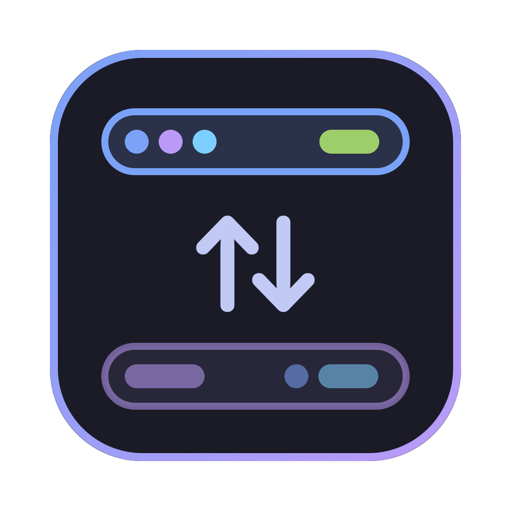

<p align="center">
  
</p>

<h1 align="center">Bar Switcher</h1>

<p align="center">SketchyBar, Barik, simple-bar, Übersicht ve Zebar arasında tek tıkla geçiş · macOS 14+</p>

<p align="center">
  <a href="https://github.com/bahayavas/bar-switcher/releases/latest/download/BarSwitcher-macOS.zip"></a>
  <a href="https://github.com/bahayavas/bar-switcher/releases/latest"></a>
</p>

## Kurulum

1. Yukarıdaki **İndir** düğmesiyle `BarSwitcher-macOS.zip` dosyasını indir (ya da sağdaki **Releases** bölümünden istediğin sürümü seç).
2. Zip'i aç ve **`Kur.command`** dosyasına çift tıkla. Bu betik:
   - `Bar Switcher.app`'i **Uygulamalar** klasörüne kopyalar,
   - uygulamanın kullandığı `switch.sh` ve ayar dosyalarını `~/bar-switcher/` klasörüne koyar (var olan `.conf` dosyana dokunmaz),
   - uygulamayı açar.
3. macOS `Kur.command` için "geliştirici doğrulanamadı" derse: dosyaya **sağ tık → Aç** de.
   Uygulama Apple tarafından imzalanmadığı için aynısı ilk açılışta uygulama için de geçerli olabilir;
   gerekirse Terminal'de: `xattr -cr "/Applications/Bar Switcher.app"`

Kaynaktan derlemek için aşağıdaki **Derleme** bölümüne bak.

---


SketchyBar, Barik, simple-bar, Übersicht ve Zebar arasında tek tıkla geçiş. Aynı anda yalnızca biri çalışır.
WM Switcher'ın (`~/wm-switcher`) kardeşi; ayrı bir uygulama (`com.bahayavas.bar-switcher`).

## Kullanım

| Nereden | Ne |
|---|---|
| Dock ikonuna tıkla | Pencere: her bar için kart (aktif olan gradyan çerçeveli, kurulu olmayan gri), "Hiçbiri", "Ayar dosyasını aç", "Yeniden başlat" |
| Dock ikonuna sağ tıkla | Pencere açmadan geçiş; aktif olanın yanında ✓ |
| `⌃⌥⇧1` … `⌃⌥⇧5` | Barlar (Ayarlar → Barlar'daki sıraya göre) |
| `⌃⌥⇧0` | Hiçbiri (normal macOS menü barı) |
| `⌃⌥⇧B` | Sıradaki bar (görünen ve kurulu barlar arasında döner) |
| Dock rozeti | Aktif barın kısa adı: SB / BK / SM / ÜB / ZB |
| `⌘,` | Ayarlar: Kısayollar / Genel / Barlar |
| Terminal | `~/bar-switcher/switch.sh <sketchybar\|barik\|simplebar\|ubersicht\|zebar\|none\|restart <id>\|restore\|status>` |

- Login'de yalnızca Bar Switcher başlar ve son seçilen barı açar (`switch.sh restore`).
  Barların kendi "launch at login" ayarlarını açma. SketchyBar için `brew services start` kullanma,
  yoksa iki bar birden açılır.
- Bir bar switcher dışından açılırsa (Spotlight, Finder…) yeni açılan kazanır, diğerleri kapatılır.
  SketchyBar bir .app olmadığı için bunu yalnızca 1,5 sn'lik yoklamada fark eder ve diğerlerini kapatmaz.
- Geçiş sırası: diğerlerine normal Quit (SketchyBar'a `TERM`) → 3 sn bekle → `TERM` → 1 sn → `KILL`.
  Übersicht Quit isteğini yok sayıyor, bu yüzden her zaman `TERM` ile kapanıyor (~3 sn sürer).
  Öksüz kalan node widget sunucusu da kapatılır.
- Seçilen bar zaten açıksa hiçbir şey yapılmaz.
- simple-bar ↔ Übersicht arasında geçişte Übersicht kapanmaz, sadece widget'lar gizlenir/gösterilir.

### Übersicht ve simple-bar

İkisi aynı uygulamayı kullanıyor. Widget'lar silinmez veya taşınmaz. Yalnızca Übersicht'in kendi
"hidden" ayarı değişir (`ubersicht-widgets.js`):

- Übersicht kapalıysa: `~/Library/Application Support/tracesOf.Uebersicht/WidgetSettings.json`
  önceden düzenlenir (açılışta yanıp sönmesin).
- Übersicht açıksa: AppleScript `set hidden of widget id "…"` (Übersicht dosyayı kendisi kaydeder).
- simple-bar → yalnızca `widgets/simple-bar/` içindeki widget'lar açık.
  Übersicht → `simple-bar` kapalı, diğer widget'lar açık.
- Widget id'si klasör yolundan gelir: `widgets/simple-bar/index.jsx` → `simple-bar-index-jsx`.

Şu an `widgets/` klasöründe yalnızca simple-bar var. Yani "Übersicht" seçilince ekranda bir şey görünmez,
ta ki `~/Library/Application Support/Übersicht/widgets/` içine kendi widget'larını koyana kadar.

simple-bar varsayılan olarak yabai bekliyor ("yabai is not running" yazar). AeroSpace ile kullanmak için
`~/.simplebarrc` dosyasına `{"global": {"windowManager": "aerospace"}}` yaz (simple-bar bunu kendi
varsayılanlarıyla birleştirir), ya da bar üzerindeki simple-bar ayarlarından seç.

### macOS menü barı

Bir bar seçiliyken `_HIHideMenuBar = true` (otomatik gizle), "Hiçbiri"de `false`. Ayar anında uygulanır
(`AppleInterfaceMenuBarHidingChangedNotification`), çıkış/giriş gerekmez. İlk değişiklikten önce eski
değer `~/.config/bar-switcher/menubar.backup` dosyasına yedeklenir. Ayarlar → Genel'de "Mac menü barını
otomatik gizle" kapatılırsa yedekteki değer geri yüklenir ve switcher bu ayara artık dokunmaz.

## Ayarlar

Hepsi `~/.config/bar-switcher/settings.json` dosyasında. Elle düzenleyebilirsin. Kaydedince uygulama
1,5 sn içinde yeniden okur. Dosya bozuksa eski ayarlarla devam eder ve pencerede hata gösterir.

```json
{
  "order": ["sketchybar", "barik", "simplebar", "ubersicht", "zebar"],
  "hidden": [],
  "shortcuts": {},
  "launchAtLogin": true,
  "notifications": true,
  "manageMenuBar": true
}
```

- `order`: rozet/kart sırası, varsayılan kısayol numarası ve "sıradaki" döngüsü
- `hidden`: pencerede, Dock menüsünde ve döngüde görünmeyen barlar (kısayolları da kapanır)
- `shortcuts`: yalnızca varsayılandan farklı olanlar. Örnek: `"barik": "ctrl-alt-cmd-b"`, `"zebar": ""` (kısayol yok)

## Kısayolları değiştirmek

Ayarlar → Kısayollar: kutuya tıkla, yeni kısayola bas. `⌫` siler, `⎋` vazgeçer, ↺ o satırı varsayılana
döndürür, "Varsayılana dön" hepsini sıfırlar. En az bir ⌃/⌥/⌘ gerekir. Değişiklik anında geçerli olur.
Biçim AeroSpace'inkiyle aynı (`ctrl-alt-shift-1`). Elle `settings.json` → `shortcuts` içine de yazılabilir.

Varsayılanlar bar sırasından gelir: görünen 1. bar `⌃⌥⇧1`, 2. bar `⌃⌥⇧2`… Sırayı değiştirince numaralar da
değişir (elle atanmış kısayollar değişmez).

Çakışma uyarısı (`Conflicts.swift`) şunlara bakar: WM Switcher (`~/.config/wm-switcher/shortcuts.json`),
AeroSpace `[mode.main.binding]`, hyprmac `bind = …`, Amethyst (`default.amethyst` + `amethyst.yml`),
macOS klavye kısayolları (`com.apple.symbolichotkeys`) ve Bar Switcher'ın kendi kısayolları.
**Not:** Amethyst'in `mod2` tuşu ⌃⌥⇧ olduğu için varsayılan ⌃⌥⇧1-5 ve ⌃⌥⇧0, Amethyst'in
`throw-space-N` kısayollarıyla çakışıyor (Amethyst açıkken hangisinin kazanacağı belli değil).
Amethyst kullanıyorsan farklı bir kısayol ata.

## Yeni bir bar eklemek

1. Barı kur.
2. `bars.conf`'a bir satır ekle:
   ```
   id|Görünen ad|tür|bundle id|/Applications/X.app|~/ayar/yolu,~/alternatif/yol|RZ
   ```
   - tür: `app` (normal .app), `binary` (tek program, ör. `/opt/homebrew/bin/x`; bundle id yerine `-`),
     `ubersicht:only=klasör` veya `ubersicht:except=klasör` (Übersicht widget seti)
   - bundle id: `osascript -e 'id of app "X"'`
   - ayar yolları virgülle ayrılır, var olan ilki açılır. Klasör Finder'da, dosya metin editöründe açılır.
   - rozet: Dock'ta görünen kısa ad
3. Bar Switcher'dan çık ve yeniden aç (Dock → sağ tık → Çık). Yeniden derlemek gerekmez.
   Yeni bar listenin sonuna eklenir, sırasını Ayarlar → Barlar'dan değiştir.

## Derleme

```
./build.sh               # swift build → build/Bar Switcher.app → /Applications (çalışıyorsa kapatır)
./build.sh --no-install
```

Ad-hoc imzalı. Kısayollar Carbon `RegisterEventHotKey` ile çalışır, Accessibility izni gerekmez.
İlk geçişte macOS "Bar Switcher, X'i denetlemek istiyor" diye sorabilir. Bu izin barlara normal Quit
göndermek ve Übersicht widget'larını açıp kapatmak için gerekli.

Dock rozeti ve geçiş bildirimleri için System Settings → Bildirimler → Bar Switcher → izin ver
(rozetler açık). Bildirim izni reddedilmişse macOS rozeti de göstermiyor.

Test araçları:
- `"/Applications/Bar Switcher.app/Contents/MacOS/BarSwitcher" --status`: aktif bar, login ve bildirim izni
- `… --snapshot <main|shortcuts|general|bars> çıktı.png`: pencereyi açmadan görünümü PNG'ye çizer
- `~/.config/bar-switcher/switch.log`: geçiş günlüğü

## Dosyalar

```
switch.sh             geçiş mantığı (uygulama da bunu çağırır)
bars.conf             bar listesi
ubersicht-widgets.js  Übersicht widget gizle/göster (JXA)
Sources/BarSwitcher   main.swift (pencereler, Dock menüsü), Switcher.swift (durum, geçiş, kısayol kaydı),
                      Settings.swift (settings.json), ContentView.swift, SettingsView.swift,
                      Shortcut.swift, HotKeys.swift, Conflicts.swift
tools/make-icon.swift ikon (build/AppIcon.icns silinirse yeniden çizilir)
```

Kurulumda yapılan değişiklikler (yedekler `~/.config/bar-switcher/backups-20261022-235346/`):
- `brew services stop sketchybar` (zaten durmuştu, artık LaunchAgent yok)
- Barik, Zebar, Übersicht: login item ya da launch-at-login ayarı yoktu, değişiklik gerekmedi
- Bar Switcher → Login Items + Dock
- Barik ilk açılışta `~/.barik-config.toml` dosyasını kendisi oluşturdu (varsayılan ayarlar)

## Lisans

[MIT](LICENSE) © 2026 Baha Yavaş
